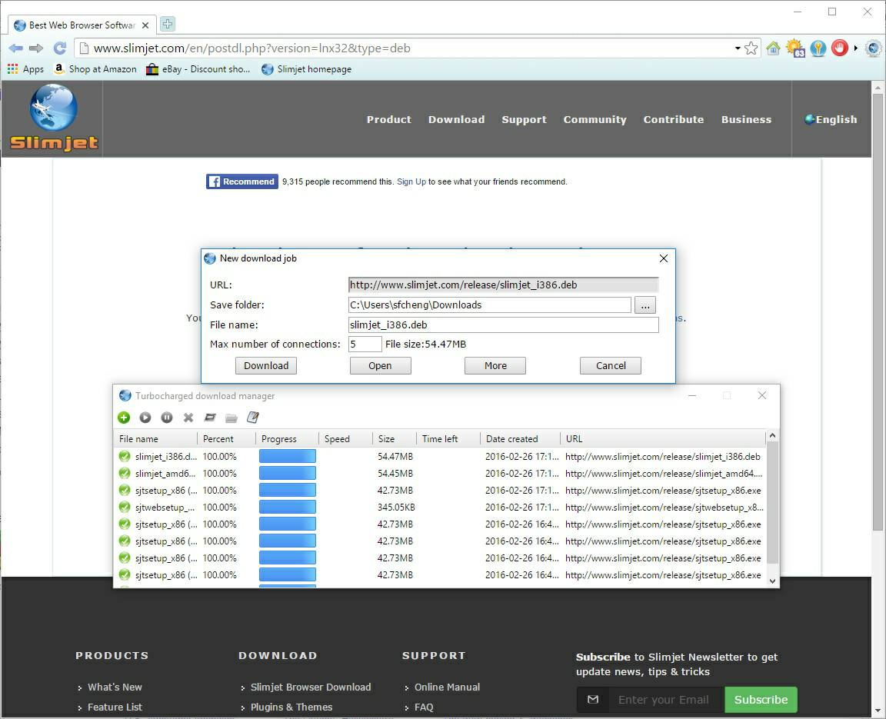
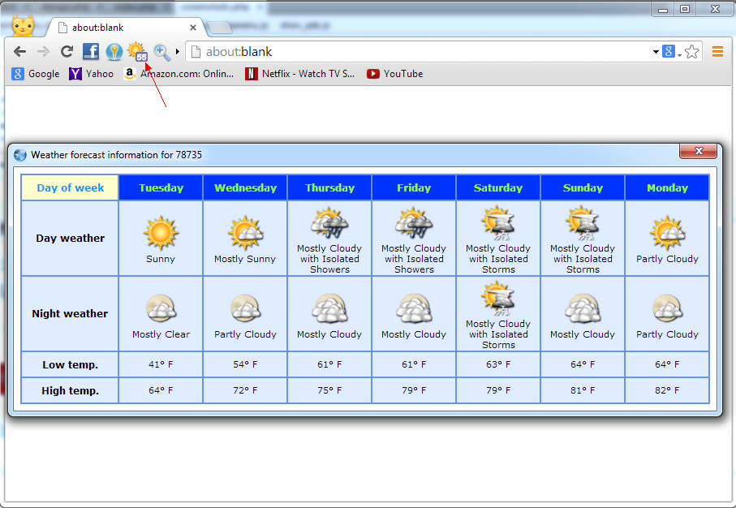

# Slimjet Chromium Browser with Integrated Web Tools

Slimjet is a Chromium-based web browser developed by FlashPeak, Inc.

It combines familiar Chromium compatibility with built-in tools for ad blocking, downloading, media capture, translation, form assistance, toolbar customization, and everyday Windows browsing.

## Project Snapshot

| Property | Value |
| --- | --- |
| Product | Slimjet |
| Developer | FlashPeak, Inc. |
| Browser engine | Chromium and Blink |
| Product type | Proprietary desktop web browser |
| Main platforms | Windows, Linux, macOS |
| Browser model | Tabbed desktop browser |
| Main focus | Compatibility, integrated tools, customization, and download performance |
| Public source repository | Not confirmed |

## Browser Experience

Slimjet is designed to provide a familiar Chromium-style browsing experience with additional utilities available from the browser interface.

The browser focuses on:

- Fast page loading
- Chromium web compatibility
- Tabbed browsing
- Customizable controls
- Integrated privacy tools
- Download acceleration
- Media downloading
- Form assistance
- Translation
- Image utilities
- Weather information
- Portable packages

## Chromium Compatibility

Slimjet is built on the Chromium and Blink ecosystem.

This provides compatibility with:

- Modern web pages
- JavaScript applications
- Chromium page standards
- Web media
- Browser extensions
- Chrome-compatible websites
- Web-based productivity tools
- Online video services

Compatibility can vary depending on the Slimjet release and the Chromium engine version included with it.

## Built-in Ad Blocking

Slimjet includes a built-in ad blocker intended to reduce unwanted advertising and page clutter.

Ad blocking can help:

- Remove common advertising elements
- Reduce visual distractions
- Lower bandwidth use
- Reduce unnecessary page requests
- Improve page readability
- Limit some tracking resources
- Reduce CPU use on ad-heavy websites

Blocking behavior may depend on filter lists, page design, and the selected browser settings.

## Download Manager

Slimjet includes a turbocharged download manager that uses parallel connections where supported.

Download workflows can include:

- Multiple simultaneous transfers
- Resuming interrupted downloads
- Faster large-file transfers
- Download progress tracking
- Session recovery
- Destination folder selection
- Download history
- Network-aware transfer handling

Actual speed depends on the remote server, network, file size, and connection limits.

## YouTube and Media Tools

Slimjet provides integrated tools for downloading online video and extracting audio.

Media workflows may include:

- Selecting available video resolutions
- Downloading supported online videos
- Saving audio tracks
- Extracting MP3 audio
- Choosing local destinations
- Managing downloaded media
- Opening media tools from the browser interface

Media availability and website compatibility can change as online services update their delivery systems.

## Chrome Web Store Extensions

Because Slimjet is based on Chromium, it is designed to support many Chrome-compatible extensions and plugins.

Extension workflows may include:

- Installing browser extensions
- Managing enabled extensions
- Removing unwanted extensions
- Using productivity tools
- Adding language tools
- Adding developer tools
- Customizing browsing behavior
- Extending media and download workflows

Users should review extension permissions before installation.

## AI and Text Tools

Slimjet includes integrated AI-oriented and text-revision tools in selected versions.

These tools may help with:

- Rewriting text
- Improving wording
- Summarizing selected content
- Translating text
- Drafting short passages
- Reviewing language
- Working with page selections

AI output should be reviewed before being used in professional, legal, medical, academic, or financial contexts.

## Toolbar Customization

Slimjet provides a customizable toolbar for frequently used browser actions.

Users can arrange access to:

- Navigation buttons
- Downloads
- Screenshots
- Translation
- Media tools
- Privacy controls
- Weather information
- Bookmarks
- History
- Page utilities
- Extension controls

Toolbar configuration can make the browser fit different browsing habits and screen sizes.

## Photo Salon

The browser includes a Photo Salon utility for basic image editing and framing workflows.

Possible uses include:

- Opening a saved image
- Applying simple adjustments
- Adding a frame
- Preparing an image for sharing
- Creating a quick visual edit
- Saving a modified copy
- Working with downloaded images

Photo tools are intended for convenience and do not replace a full image editor.

## Translation

Slimjet includes built-in webpage and text translation features.

Translation can assist with:

- Reading foreign-language websites
- Translating selected text
- Understanding navigation
- Comparing multilingual content
- Supporting research
- Reading documentation
- Reviewing international pages

Machine translation may contain errors and should be checked when accuracy matters.

## Weather Information

Slimjet includes a weather display among its integrated convenience features.

The weather panel can provide:

- Current conditions
- Local forecasts
- Quick information while browsing
- A compact browser-side utility
- Optional location-based information

Weather availability may depend on external services and browser configuration.

## Portable Editions

Slimjet is distributed in portable editions for selected platforms and releases.

Portable use can be useful when:

- Installation privileges are limited
- A separate browser profile is needed
- A user wants to carry browser settings
- A temporary browsing environment is required
- A browser must remain isolated from a system installation
- Several browser copies are maintained

Portable profiles may contain cookies, history, form data, downloads, and saved credentials. Protect the storage location accordingly.

## Privacy and Security

Slimjet includes ad blocking and privacy-related controls, but these do not replace a complete security strategy.

Users should also consider:

- Browser update availability
- Chromium engine age
- Extension permissions
- Downloaded file safety
- Password protection
- Website certificates
- Tracking scripts
- Operating-system updates
- Antivirus software
- Account security
- Multi-factor authentication

The browser is proprietary, and its internal implementation should be evaluated through official product information and release notes.

## Supported Platforms

Slimjet has been associated with desktop builds for:

- Windows
- Linux
- macOS

Historical releases have included multiple processor architectures and portable packages.

Support for a specific operating-system version depends on the release being used.

## Windows Usage

Windows users may use Slimjet for:

- Daily browsing
- Online video
- Download management
- Web applications
- Extension-based workflows
- Multilingual browsing
- Image downloads
- Form completion
- Portable browser sessions
- Older Windows compatibility scenarios

Users should confirm whether the selected release supports their Windows version and architecture.

## Linux and macOS Usage

Linux and macOS availability may vary by release and distribution channel.

Before choosing a package, verify:

- Operating-system version
- CPU architecture
- Package format
- Required system libraries
- Chromium compatibility
- Extension support
- Update availability
- Portable package behavior

Older packages may not support current websites or current security requirements.

## Account and Form Data

Slimjet's QuickFill and login-related tools may store information used to complete forms.

Users should:

- Protect the operating-system account
- Avoid storing credentials on shared devices
- Review saved information regularly
- Remove old accounts
- Use strong unique passwords
- Enable multi-factor authentication
- Protect portable copies
- Back up sensitive data securely
- Avoid exposing profile folders

## Download Safety

Integrated download tools make it easier to save files, but every downloaded file still requires verification.

Recommended practices include:

- Download from trusted sources
- Check file extensions
- Scan executable files
- Avoid unexpected installers
- Verify signed packages
- Keep the browser updated
- Do not disable security warnings without a reason
- Use separate folders for temporary files

## Reference Source Material

The supplied local reference files belong to Falkon, a different open-source Qt browser project. They are included as structural and packaging references, not as Slimjet source code.

The reference build configuration is available in [CMakeLists.txt](./CMakeLists.txt).

Project history is represented by [CHANGELOG](./CHANGELOG).

The reference license file is [COPYING](./COPYING).

Packaging metadata is available in [snapcraft.yaml](./snapcraft.yaml).

## Reference Test Material

The local reference set includes browser tests for:

- Ad blocking
- Cookies
- Password storage
- Location bars
- Search engines
- Site settings
- Tabs
- Web views
- Updater behavior
- SQL-backed storage

Relevant test files include [autotests/adblocktest.h](./autotests/adblocktest.h), [autotests/cookiestest.h](./autotests/cookiestest.h), [autotests/locationbartest.h](./autotests/locationbartest.h), and [autotests/opensearchenginetest.cpp](./autotests/opensearchenginetest.cpp).

Additional test references include [autotests/sitesettingstest.h](./autotests/sitesettingstest.h), [autotests/tabmodeltest.h](./autotests/tabmodeltest.h), and [autotests/webviewtest.cpp](./autotests/webviewtest.cpp).

## Reference Packaging Files

The supplied files also contain macOS packaging references:

- [mac/create_dmg.sh](./mac/create_dmg.sh)
- [mac/create_dmg.scpt](./mac/create_dmg.scpt)
- [mac/macdeploy.sh](./mac/macdeploy.sh)
- [mac/qt-mac-silent-install.qs](./mac/qt-mac-silent-install.qs)

These files describe the reference project's packaging approach and should not be interpreted as Slimjet build instructions.

## Reference Documentation

The reference QML API documentation is stored in [doc/qml_api.dox](./doc/qml_api.dox).

The reference assets include [autotests/autotests.qrc](./autotests/autotests.qrc) and [autotests/CMakeLists.txt](./autotests/CMakeLists.txt).

Together, these files show how a browser project can organize tests, resources, documentation, and platform packaging.

## Product Status

Slimjet is a proprietary browser distributed by FlashPeak.

The public research brief did not confirm a current release number or public source repository.

Users should verify current availability, supported platforms, download authenticity, and security maintenance through official FlashPeak channels.

## License and Ownership

Slimjet and the Slimjet name are associated with FlashPeak, Inc.

The exact license terms, redistribution permissions, trademark conditions, and proprietary component notices should be reviewed in the official product materials and installer terms.

## Related Search Terms

slimjet browser, flashpeak slimjet, slimjet web browser, slimjet chrome, slimjet portable, chromium-browser, ad-blocker, download-manager, youtube-downloader, chrome-extensions, privacy-browser, portable-browser, windows-browser, browser-tools
